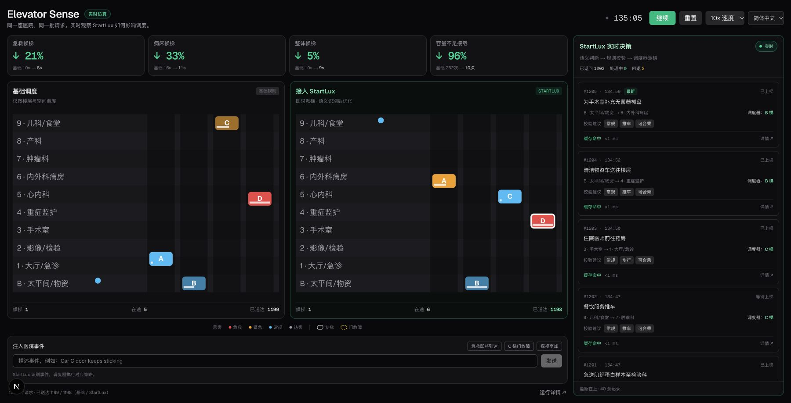

# Elevator Sense

**We're very good at optimizing numbers. What we can't do is optimize for meaning, because meaning never makes it into the numbers.** Elevator Sense tests whether [Jev](https://typesafe.ai/blog/introducing-system-one-models-and-jev) (TypeSafe AI's fast, structured-decision model) can supply that missing input. An experiment built at JEVATHON (Jev Hackathon SF, Sept 26 2026).

**Try it:** the demo runs locally with your own TypeSafe API key. See [Run it locally](#run-it-locally), which takes about two minutes.

## The idea

The math of dispatch is mature: distances, travel times, queues. But the right decision often depends on meaning the optimizer never sees. A hospital elevator knows *where* you're going, not *who's* waiting. A trauma patient on a bed, a nurse on break, and a family going to the cafeteria all look like the same hall call.

Language models can read that meaning, but waiting for each call can stall a control loop. This version uses a nonblocking harness: visible request facts start dispatch immediately, and the configured decision model refines requests that have not boarded. The UI retains the Jev name; the current default provider is StartLux Decision 4B, and the actual model name is shown in run details.

The experiment runs identical elevator banks side by side, with the same building, request stream, speed, doors, and physical capacity. The baseline dispatcher is unchanged. The enhanced side adds text evidence, model interpretation, capacity constraints, and reservation/queue policies. Its gains measure the whole harness; they must not all be attributed to the model alone.

## How it works

Every request arrives as a free-text note, e.g. *"Bed transport ER to ICU, pt intubated, need to go NOW"*.

**1. The model reads the note** in one call with three questions ([`src/lib/jev/interpretRequest.ts`](src/lib/jev/interpretRequest.ts)). Hospital floor names are excluded so a destination such as ICU cannot turn an ordinary staff trip into a critical patient transfer:

| Question | Type | Answers |
|---|---|---|
| How time-critical is this trip? | Multiple choice | `stat` · `urgent` · `routine` · `visitor` |
| What will occupy the elevator? | Multiple choice | `bed` · `wheelchair` · `cart` · `walking` |
| Does this trip need a car with no other passengers? | Yes/no | probability of "yes", 0–1 |

Raw model answers, evidence corrections, cache status, and current-call latency are retained for inspection. Confidence signals are not calibrated guarantees of correctness.

**2. Plain code turns the answers into rules** ([`src/lib/sim/policy.ts`](src/lib/sim/policy.ts)):
- **Space:** bed = 10 units (a full car), cart = 5, wheelchair = 3, walking = 1 per person; explicit group sizes are counted.
- **Own car:** STAT and beds require an empty car. Other requests need explicit exclusivity evidence or a strong validated model signal. A probability near 0.5 is insufficient.
- **Nonblocking:** provisional dispatch begins immediately. Model refinements may safely change an unboarded request; late responses cannot change an onboard passenger's route or capacity profile.
- **Bounded calls:** a 2.5-second default deadline includes queue time and retries, with two concurrent calls, cancellation propagation, exact-note deduplication, and a bounded five-minute cache. Timeout retains provisional service.

**3. Dispatch uses shared ETA calculations and physical simulation** ([`src/lib/sim/engine.ts`](src/lib/sim/engine.ts)). For each request it rules out unsuitable cars and minimizes estimated pickup time plus passenger disruption.
- **Without Jev:** every request is treated as one ordinary passenger, handled first-come-first-served, with every passenger weighted 1.
- **With Jev harness:** urgency, capacity and own-car rules apply, with queue aging to protect long-waiting requests. A bed can reserve a car's next empty trip while its current riders are delivered first. Adding stops to a car carrying a STAT patient costs more (weight 10 vs. 3 urgent, 1 otherwise).

Jev never picks the elevator or does arithmetic. **Jev supplies the meaning; the optimizer still does the optimizing.** That split is deliberate: TypeSafe's docs note Jev is weak at numbers, and the numeric part is already solved.

**4. Live events.** Free text typed into the event box ("Car C door keeps sticking", "Trauma incoming to the ED in 5 minutes") goes through a second model call (event type, floor, car). The physical effect happens in both buildings, but only the enhanced side responds: it reroutes unboarded urgent requests off a faulty car, holds an empty car for an incoming emergency, or pre-positions cars for a crowd. Unused reservations expire after 90 simulated seconds.

**What's shared and what's hidden.** Each simulated request has a hidden answer key (true priority, true size). No dispatcher sees it. It's used only for physics (does the bed actually fit?) and for scoring.

## Measuring the current harness

### Inspecting StartLux decisions in the browser

The interface defaults to **English**. Use the **English / 简体中文** selector in the top right to switch instantly; the preference is saved in this browser. The page heading and browser tab show **Elevator Sense** in English and **智能电梯调度** in Chinese. Switching languages preserves the running simulation, metrics, event input, and decision feed. Floor labels, sample request summaries, details, and recorded actions are localized for display; actual model inputs, original request text, and raw JSON remain unchanged.

The desktop dashboard fits one screen: comparison metrics, both elevator banks, and event controls sit on the left; **StartLux 实时决策** streams the latest 40 requests on the right. New requests pop in at the top and smoothly push older cards downward, without scrolling the panel. Model results update in place. Scroll down to browse a frozen window of older records; a new-decision count appears while arrivals continue. Click **Show latest / 回到最新** to return to the live stream. On smaller screens the panels stack vertically.

Each card summarizes the request, route, priority, load, dedicated-car recommendation, actual assigned car, and response status. Click it to open a separate, scrollable dialog with the exact model input, raw scores and confidence, harness corrections, and the constraints actually applied. The selected record stays open while new requests arrive. Cache hits, shared responses, failures, and results arriving after pickup are explicitly labeled.

The car-selection table records A–D eligibility, exclusion reasons, and the ETA/disruption/penalty calculation from the actual dispatch step. StartLux supplies structured judgments; the dispatcher calculates these scores and selects the car. Historical assignments remain visible if a request is rerouted. These records show observable inputs and outputs, not a generated explanation of hidden model reasoning. Event results also expose the model classification and the actual dispatch actions.



See the [2026-10-29 validation report](docs/validation-2026-10-29.md) for actual provider results, independent traffic seeds, live browser verification, model-versus-rules attribution, and remaining regressions.

`npm run evaluate -- all` records real model answers, then replays their measured latency with a running simulation clock over seeds 101–116. It compares baseline, evidence-only rules, full harness at 1×/10×, cold requests, slow responses, and complete model outage. Physical events are fixed independently of model answers. Every per-seed regression is retained; final completed-request metrics are included after draining the queues. `npm run evaluate` repeats the replay from the saved recordings and rejects stale interpreter hashes.

These are simulations, not hospital measurements. Replay approximates queueing and does not replace a live browser run. The default 10× animation also advances ten simulated seconds per real second; dispatch continues during inference. Wait metrics include ongoing waits and end at pickup, not destination arrival. Capacity failures count attempts across all passengers, not unique beds.

## Original author's historical results

The following table is retained as historical context. It predates the current harness/provider validation. Its `tune` script freezes simulation time while awaiting the model, so it does **not** include inference latency and must not be presented as the current live result.

**The optimizer didn't get smarter; it got better inputs.** Mean over **16 randomized traffic scenarios that were not used while tuning** (seeds 101–116, 20 simulated minutes each, three live events per run, real Jev answers):

| | Without Jev | With Jev | Change |
|---|---|---|---|
| Emergency (STAT) patients wait | 46.2 s | 13.2 s | **−71%** |
| Patient beds wait | 80.0 s | 23.7 s | **−70%** |
| Everyone waits (average) | 31.2 s | 19.2 s | **−38%** |
| Worst single wait | 342 s | 162 s | −53% |
| Trips where the bed didn't fit | 120 | 3 | −98% |

Jev came out ahead on priority-weighted wait in 14 of 16 scenarios. Reproduce with `SEED_START=101 SEEDS=16 npm run tune`.

## Caveats (read these)

- **I wrote the test requests.** The ~40 request phrasings and the question definitions came from the same author, so Jev's accuracy on real hospital language is unproven. Requests written by someone else are the next test.
- **It's a simulation.** The simplified physics (speed, door times, capacity) and traffic mix are assumptions, not hospital data.
- **The baseline is a textbook dispatcher** (an estimated-time-of-arrival rule plus a per-passenger delay penalty), not a commercial group controller. The claim is "the same optimizer with vs. without semantic inputs", not "better than industry systems".
- **Some wording was tuned.** A few question definitions were adjusted after seeing Jev's first answers (e.g. lab samples labeled "stat" count as urgent, not emergencies).
- **Jev isn't perfect.** It lost in 2 of 16 scenarios. Giving critical patients their own car costs capacity, so results depend on the traffic mix.

## Run it locally

Requires Node 20+ and a decision API that speaks the TypeSafe Jev schema (`/v1/systemone`): the LAN StartLux server (`http://10.6.108.25:8090`, no key) by default, or a hosted gateway with `DECISION_BASE_URL` + `DECISION_API_KEY`. `think_mode` defaults to `never` — on the LAN host a thinking pass costs seconds, which the control loop can't absorb.

```bash
npm install
cp .env.example .env.local   # defaults work against the LAN server as-is
npm run dev                  # http://localhost:3000
```

Scripts:
- `npm test`: regression tests for dispatch invariants, evidence handling, cache, and cancellation
- `npm run evaluate -- all`: capture real model answers and run latency-aware comparisons; saves recordings/results under `docs/`
- `npm run evaluate`: replay the saved recordings with source-hash checks
- `npm run smoke`: a few real Jev calls with answers and latency printed
- `npm run tune`: historical policy-only benchmark that freezes time while awaiting inference
- `npm run headless`: a single real-time run in the terminal

## Project layout

```
src/lib/jev/        Jev calls: request and event interpreters (server-side only)
src/lib/sim/        simulation: traffic (world, corpus), policy, dispatcher/physics (engine)
src/app/api/        API routes the browser calls; the Jev key stays on the server
src/components/     dashboard UI
scripts/            smoke test, benchmark, headless run
docs/CONCEPT.md     design notes
```

## What's next

1. Test on requests written by other people, and measure Jev's accuracy on each question.
2. Calibrate confidence and evidence constraints on a larger independent language set, including negated/cancelled trips, and track cases where the model adds cost versus the rules-only arm.
3. Compare against published dispatch algorithms (nearest car, estimated time to destination) and open-source simulators.
4. Generalize the pattern: take optimization that's already solved numerically and give it the semantics it's missing. The same setup (questions + rules + dispatcher) applies anywhere meaning changes the right answer: hospital porters, ambulances, warehouse robots, job queues.
