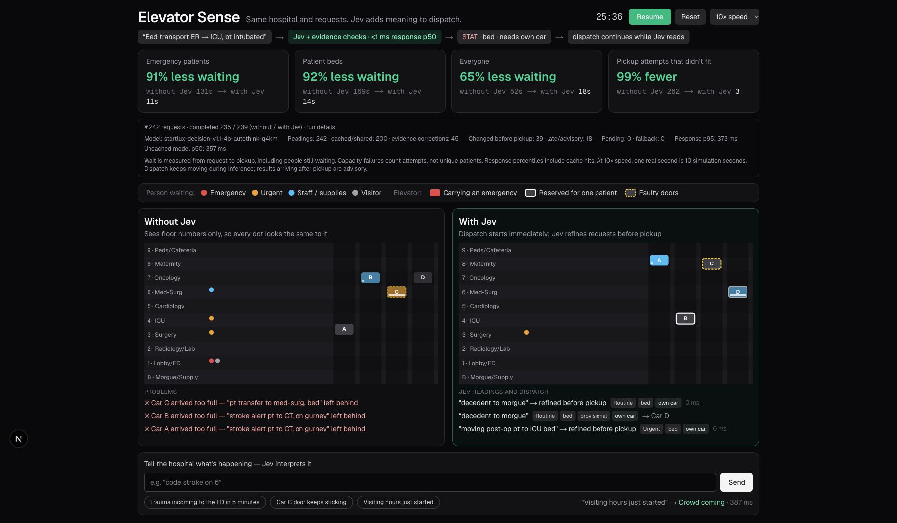

# Harness 验证：2026-10-29

当前 harness 相比不读请求文本的原始基线，在最终保留的 16 个新流量种子上，四项主指标的**平均值均改善**。这不代表每个场景、每个乘客或模型的独立贡献均改善：总体平均等待在种子 205、206、210 上仍退步。所有场景及退步值均保留在 JSON 中。

## 数据来源与范围

- 实际模型：`startlux-decision-v1.1-4b-autothink-q4km`。页面的 JEV 名称表示兼容接入，不是这次调用了 TypeSafe 托管模型。
- 真实采集：46 个不同的模拟交通文本、16 个开发分类样本、14 个最终新措辞样本，以及 3 个事件。返回的原始类别、概率、置信信号、规则调整和延迟都保存于 [recordings](validation-2026-10-29-recordings.json)。交通请求冷调用延迟中位数 353 ms，P95 480 ms。
- 性能结果是**真实模型回答的确定性延迟回放**，不是重新发起每次请求的实时浏览器测量。回放期间仿真继续前进，模拟真实延迟、2 个并发槽位、排队和 2500 ms 总截止时间。
- 缓存按请求正文去重，每个场景从空缓存开始；TTL 为 300 秒真实时间，LRU 上限 256 条。缓存命中按 0 ms 近似，结果在下个 0.25 秒仿真步生效；浏览器/HTTP 额外开销不在回放中。
- 101–116 是已查看过结果的固定评估种子；201–216 在实现冻结后运行，作为最终流量保留集。两组复用相同的真实回答，模型只接收正文。随机流量仍来自现有人工编写的交通模板，不能等同于新医院语言数据。
- 两侧收到相同请求和预先固定的真实事件；事件物理效果不依赖模型是否解释成功。只有模型侧根据真实事件解释结果更新策略。脚本断言不同场景的基线结果一致、两侧请求数量相同。
- 隐藏真值仅用于物理容量和评分，不进入模型或调度。没有为了显示优势暂停仿真时间，也没有删掉失败种子。

## 最终流量保留集：201–216，10×，20 分钟观察窗口

以下为 16 次运行的指标均值，时间单位是仿真秒。等待从请求到上梯；观察窗口末还未上梯的人按已经等待的时间计入。容量失败统计所有装不下的上梯尝试，同一请求可以重复计数。

| 指标 | 无 JEV | 完整 harness | 相对变化 | 退步的种子 |
|---|---:|---:|---:|---|
| 急救平均等待（秒） | 40.5 | 14.7 | -63.6% | 无 |
| 病床平均等待（秒） | 65.2 | 19.6 | -69.9% | 无 |
| 总体平均等待（秒） | 26.1 | 19.2 | -26.3% | 205, 206, 210 |
| 容量不足无法上梯（次） | 115.9 | 3.0 | -97.4% | 无 |
| P95 等待（秒） | 110.1 | 67.1 | -39.1% | 205, 206, 210 |
| 最久等待（秒） | 286.2 | 168.0 | -41.3% | 203, 206 |
| 20 分钟内完成运输（次） | 171.4 | 178.1 | +3.9% | 213, 216 |

停止新请求后另加最多 600 秒排空，结果另存为 `afterDrain`，不把它冒称为全部完成：全部 16 次运行合计，JEV 侧仍未完成 0 次，基线仍未完成 28 次。观察窗口和排空后指标不能混用。

## 不同运行条件与贡献归因

下表仍是 201–216 的 20 分钟均值；基线各条件完全一致：急救 40.5 秒、病床 65.2 秒、总体 26.1 秒、容量失败 115.9 次。

| 条件（均为回放） | 急救等待 | 病床等待 | 总体等待 | 容量失败 |
|---|---:|---:|---:|---:|
| evidence-only-no-model | 12.5 | 19.2 | 18.3 | 6.8 |
| live-1x-cache | 13.5 | 20.0 | 19.5 | 3.9 |
| live-10x-cache | 14.7 | 19.6 | 19.2 | 3.0 |
| cold-10x-no-cache | 13.8 | 18.6 | 19.1 | 3.3 |
| slow-10x-2500ms | 12.5 | 19.2 | 18.3 | 6.8 |
| outage-10x | 12.5 | 19.2 | 18.3 | 6.8 |

`evidence-only-no-model` 只运行直接文本证据和新的调度规则，从不调用模型，也不应用模型事件策略。`slow-10x-2500ms` 是延迟达到总截止时间、全部超时的压力测试；`outage-10x` 是全程故障注入。两者仍继续提供临时调度，不让乘客因模型挂起而原地等待。

**大部分收益来自非阻塞调度、直接证据和容量/专梯规则。不能把它全部算作模型收益。** 相比仅规则，完整模型在保留集把容量失败从 6.75 降到 3.00、最久等待从 178.2 降到 168.0 秒，但总体等待从 18.3 增到 19.2 秒，急救也从 12.5 增到 14.7 秒。模型平均每轮在上梯前实际修改了 23.2 个乘客的优先级、空间或专梯安排；这一计数只证明参与，不证明改动一定有益。

已查看的固定种子 101–116，完整 10× harness 的四项结果为：急救 46.2→13.1 秒，病床 80.0→17.9 秒，总体 31.2→19.2 秒，容量失败 120.4→4.6 次。总体等待仍在 102、105、110 退步。

## 分类质量与已知剩余问题

| 样本集 | 原始模型优先级 | 处理后优先级 | 原始模型载荷 | 处理后载荷 |
|---|---:|---:|---:|---:|
| 开发样本 16 条 | 16/16 | 16/16 | 16/16 | 16/16 |
| 最终新措辞 14 条 | 14/14 | 14/14 | 13/14 | 13/14 |

最初一版规则把原本正确的模型答案覆盖成错误答案。原始记录保存在 `validation-2026-10-29-iteration1-recordings.json`；16 条样本因此成为开发回归集，不能继续称为未见测试。修复后另写了 14 条新措辞，看到结果后未再针对它们调整代码。

最终新措辞中存在一处保留失败：`Wheelchair appointment cancelled. The ward clerk will walk to reception alone.` 原始模型判步行，规则却把已取消的轮椅预约当作实际载荷，最终为轮椅。这会高估空间，尚需进一步处理否定/取消的语义。另一方面，去停尸房的委婉表述原始模型判步行，证据规则修正为病床，因此载荷总分不变，但错误位置不同。专梯规则正确 14/14 不代表模型原始 yes/no 答案全部正确，JSON 分别记录 `exclusiveCorrect` 与 `rawExclusiveAnswerCorrect`。

## 工程验证

- 12 个回归测试通过，覆盖异步调度、迟到/失败回答、专梯约束、队列与取消等实际边界。
- TypeScript 检查与 ESLint 通过。
- 生产构建 `npm run build -- --webpack` 通过；默认 Turbopack 构建曾受当前环境端口绑定 `EPERM` 阻挡，因此使用项目支持的 webpack 构建路径验证。
- 浏览器实时运行由主任务另行核对；其结果应与上述记录回放分开报告，不能以回放代替端到端验证。

## 复现

```bash
# 对当前配置的真实模型重新采集；会覆盖当前 recordings。
node --import tsx --env-file=.env.local scripts/evaluate-harness.ts record

# 不调用模型；重放固定评估种子。
node --import tsx --env-file=.env.local scripts/evaluate-harness.ts replay

# 不调用模型；最终流量保留集。
SEED_START=201 SEEDS=16 REPORT_PATH=docs/validation-2026-10-29-holdout-results.json \
  node --import tsx --env-file=.env.local scripts/evaluate-harness.ts replay

npx tsc --noEmit --incremental false
npx eslint scripts/evaluate-harness.ts scripts/fixtures/harness-cases.ts scripts/fixtures/harness-holdout.ts
```

记录包含解释器源码哈希；回放包含解释器、调度器、物理/交通定义和验证脚本哈希。解释器相对记录发生变化或进程运行中源码改变时，脚本拒绝生成最终报告，需要重新采集或启动新回放进程。`ALLOW_RECORDING_DRIFT=1` 只允许明确标记的探索性回放，不适用于最终成绩。

完整数据：[固定评估结果](validation-2026-10-29-results.json)、[最终流量保留集](validation-2026-10-29-holdout-results.json)。第一轮性能报告是探索记录（当时调度源码仍在变动），不用于最终结论。

## 浏览器实时验证

在原有 `http://localhost:3000/` 页面重置后，以 10× 运行新版 harness（页面默认种子 4）。通过页面依次提交了紧急病人到达、C 梯门故障、探访高峰，分别返回正确的 Emergency incoming / Faulty elevator Car C / Crowd coming；事件响应约 515 / 373 / 387 ms。这是独立的实时页面运行，其事件提交时刻和观察窗口不同于上面的固定回放，不应混合计算均值。

在仿真 25:36 保存的截图中，242 条相同请求的页面读数如下（页面时间显示已四舍五入）：

| 指标 | 无 JEV | 新 harness |
|---|---:|---:|
| 急救等待 | 131 秒 | 11 秒 |
| 病床等待 | 169 秒 | 14 秒 |
| 总体等待 | 52 秒 | 18 秒 |
| 容量失败 | 262 次 | 3 次 |
| 完成运输 | 235 次 | 239 次 |

242 条解释均有返回，其中 200 次缓存/共享命中，0 次失败回退；39 次在上梯前实际改变约束，18 次在上梯后返回并仅作记录。未缓存模型调用 P50 为 357 ms；包含缓存的响应 P95 为 373 ms。页面已区分缓存响应和模型推理时间。


